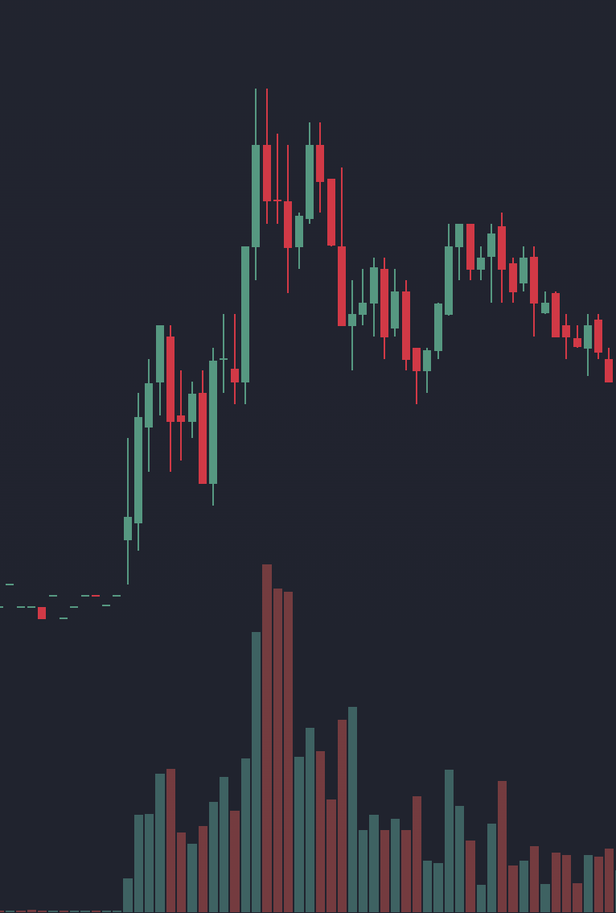

# Find Your Levels: Complete Static Content Blueprint

> **Purpose of this document:** This is the working revision of the static text for **Find Your Levels**, used to generate the seven-chapter local review site (`v3/index.html`). The local `/v3/` review build is generated from this draft; publishing the root page is a separate release step. It preserves the practical trader voice while developing:
> 1. **Technical analysis through momentum-stock examples** (using participation, price structure, and context to explain why a reference matters).
> 2. **Volume and price response together** (using historical activity to identify areas worth examining, then reading what happens when price returns).
> 3. **Four Reasons to Buy or Sell** (opening and closing longs and shorts, their changing incentives, and how their orders can reinforce a move).
> 4. **Break, Retest, Reclaim & Rejection** (teaching **Break, Retest, Reclaim, and Rejection** across **HOD, VWAP, PMH, and Macro Levels**).
> 5. **Gaps, Wide-Range Candles & Room to the Next Level** (checking the structure inside a historical daily move and keeping references such as the Daily 200 EMA in view).
> 6. **Consistent applications** (connecting the map, the developing response, and the setup's invalidation without treating an indicator or participant story as a guarantee).
>
> **Editorial approach (October 13, 2026):** State chart observations directly. Use participant stories to explain incentives and form a working read; distinguish a losing position from a triggered stop or required liquidation. Strengthen or weaken that read with specific subsequent evidence. Explain the evidence boundary where it matters, then keep the prose moving. Do not attach unsupported probabilities to an interpretation or repeat generic caveats in every paragraph.
>
> New chart examples are represented as `[Image Placeholder]` specs for real cases to capture later; the existing SVG illustrations remain where noted. Label observable events on the chart; keep inferred motives in the explanation. Select examples from the available evidence, including failed or unresolved tests, rather than forcing every chart to match a successful setup. Numeric participant stories are hypothetical unless an actual source is identified. Prices in chart briefs illustrate the intended relationships: use the actual values from the selected case and never alter market data to fit a brief.

## Voice & Tone: Author Guidance

**Sound like a patient, knowledgeable guide looking at a chart alongside the reader: clear, friendly, curious, and practical.** The reader recognizes candles but may be new to participant roles. Set those roles in context briefly, then build from price and volume to trend, level mapping, indicator context, setups, and planning. Give each full concept one home; use brief previews and practical applications to connect the chapters. Preserve that depth while making the explanation easy to follow.

- **Start with something visible.** Describe the move or level, explain why it matters, and point to the next useful observation. Let the reader follow the reasoning.
- **Use plain language with real trading vocabulary.** Introduce terms such as *absorption*, *reclaim*, and *liquidity* beside the example that makes them useful. Explain a phrase like “longer-term context” before reaching for jargon such as “regime.”
- **Make the learning concrete.** Use short participant stories, simple prices, and comparisons between a hold and a failure. Explain the purpose of a rule or drawing choice.
- **Treat mistakes without judgment.** Chasing, hesitation, and hoping for break-even are recognizable pressures. Describe what helps the reader respond; avoid labels like “dumb money,” ridicule, or “read it correctly” instructions.
- **Be clear about evidence.** State observations directly and present participant incentives as a working explanation. Use a specific next test to show what would change the read, instead of stacking “maybe,” “possibly,” and generic warnings.
- **Invite attention and keep decisions precise.** “Notice the higher low” and “watch the return to $5” help readers learn. State a setup's trigger and invalidation clearly, and make waiting or reassessing a normal part of the process.
- **Keep punctuation natural.** Prefer complete sentences, commas, and occasional colons to em dashes. Read the sentence for flow instead of replacing punctuation mechanically.
- **Keep the energy grounded.** Familiar images such as floors, ceilings, and trend rails can help. Use them sparingly; explain the price behavior behind them. Avoid hype, automatic-win language, and unsupported claims about what all traders are doing.

**Voice example:**

> Price is returning to the $5.00 base where the earlier rally began. Notice whether the pullback slows and price starts moving away from that area again. That response supports the demand-zone read. If price instead moves below the base and struggles to regain it, we have a reason to update the map.

*This section guides the writing and chart captions; it is not a separate lesson in the published guide.*

---

## Hero & Introduction

- **Badge:** `Technical Analysis · Participation, Volume & Structure`
- **Title:** `Find Your Levels`
- **Subtitle:** A practical guide to reading price action, understanding participation, and planning around meaningful levels.

### Guide Introduction
**Subtitle:** Finding your levels starts with understanding why certain prices deserve your attention. A prior high, a consolidation area, or a level reclaimed after a selloff can give you a reference for the next move. What matters is how price behaves when it gets there, how much participation accompanies the response, and what happens next.

Start with the reasons traders buy and sell, then learn to read price and volume, follow the trend, and map the levels that matter. Indicators add context, setups define the response to wait for, and the final chapter brings those pieces into a trade plan. Using active momentum stocks, the guide connects daily context with intraday decisions. The goal is to explain your level map, recognize what strengthens or weakens the read, and know when the response offers a trade or a reason to wait.

---

## Chapter 1: What Moves Price (`#m1`)

### Chapter Lead
Imagine a stock making a strong morning run after news brings it into focus. It reaches **$6.00**, then starts falling. One trader bought near the high, expecting another leg up. Another bought earlier and still has a profit. Someone watching from the sidelines is wondering whether the move is over or just taking a breath.

Follow that stock through a retreat and a recovery. The same price can become an opportunity, a place to take profit, or a chance to exit. This chapter helps you understand those different decisions and why they matter when price returns to a level.

### One Price, Different Decisions
The trader who bought near $6.00 expected the run to continue. Buying shares with that expectation is **going long**. As price falls toward $5.20, the position is losing money. The earlier buyer, who entered below $5.20, is watching some of a profit disappear instead. The same decline feels different to each of them.

Another trader sees a bounce fail during the retreat and **sells borrowed shares short**, expecting lower prices. A short seller aims to buy the shares back for less than they sold them for. That purchase closes the short position and is called **covering**. Buying can therefore be an exit from a bearish trade as well as the start of a bullish one.

Now imagine the stock finding its footing near $5.20 and recovering toward $6.00. The trader who bought near the high sees a chance to get out close to break-even. The earlier buyer sees a chance to take profit before another rejection. Both consider selling, for different reasons.

Their potential selling is one explanation for **overhead supply**: selling interest that a recovery encounters at higher prices. New short sellers might also take interest near $6.00, expecting the earlier ceiling to hold again. If some holders added shares lower down, their average cost and preferred exit may have changed. There is no single break-even price shared by everyone.

For the short seller who entered during the decline, the recovery is now moving against the position. In this example, they choose to buy back the shares and exit. Another short might hold, reduce, or have entered at a higher price and still be profitable. Meanwhile, a trader who missed the morning run sees price challenging $6.00 and considers buying for the first time.

**Same price, different decisions.** Some traders want out, some want in, and others are waiting to see whether the recovery can hold its ground. Their situations help us understand why a familiar area can matter again. The chart's response shows how the activity is resolving.

### Buying and Selling: A Quick Recap
The choices in that story fall into four common position changes:

| Position Change | Action | A Participant Story at a Level |
| :--- | :--- | :--- |
| **Opening or Adding to a Long** | Buy shares. | A trader buys a breakout or adds after a retest holds, expecting the move to continue. |
| **Closing or Reducing a Short** | Buy shares to cover. | A short seller takes profit near support or buys back after a recovery challenges the bearish read. |
| **Closing or Reducing a Long** | Sell shares. | A holder takes profit near resistance, exits around break-even, or cuts a loss after support fails. |
| **Opening or Adding to a Short** | Sell shares short. | A trader sells a failed rally or a breakdown, expecting lower prices. |

These are position changes, so the same trader can appear in different rows over time. Someone buying is not necessarily making a fresh bullish bet; they might be closing a bearish trade. Someone selling might be taking a profit.

Different reasons can produce orders in the same direction. **New long buying and short covering can reinforce an advance; long exits and new short selling can reinforce a decline.** Covering can also lock in a profit; it does not always mean a short is losing.

### Understanding Supply and Demand
**Demand is willingness to buy a quantity of shares at a particular price. Supply is willingness to sell.** Both change as price moves and traders reconsider their plans. A trader waiting to buy a dip and a short seller buying to exit have different reasons to act, but both bring buying interest to the market.

That raises a useful question: **if every completed trade has a buyer and a seller, why did our stock move down and then recover?** Look at **urgency and available liquidity**: who is willing to transact now, and how much can be bought or sold at nearby prices. A **bid** is a price someone offers to pay; an **offer** is a price someone offers to sell at.

If buying keeps taking offered shares faster than selling interest replenishes, trades can move to higher offers. Sellers accepting lower bids can similarly move price down. Orders can also be withdrawn, leaving less interest in the way. Substantial trading can therefore produce little movement, while lighter trading can sometimes move price farther.

Return to the stock finding its footing near $5.20. The decline stops making progress, price spends time in a small range, and then it rallies. That area gives us somewhere to watch if price returns. Some earlier holders may have exited during the pause, but the visible change is the structure. We will use supply and demand zones to mark some of these interactions in Chapter 4. For now, focus on the change in behavior: selling was moving price down, then it no longer did.

> **[Blue Callout] Companies Can Add Supply Too:** A company can raise money by issuing and selling additional shares, including through an **at-the-market offering**, where a broker sells into the existing market on its behalf. Issuing new shares adds shares outstanding and can dilute existing shareholders' ownership percentage. Check company announcements and filings for that context; heavy selling on a chart alone does not identify the seller.

### Support, Breakouts & Short Sellers
The recovery brings our stock back toward $6.00. The earlier retreat gives us a **resistance** reference: an area where the advance stalled or turned lower. The pause and recovery near $5.20 give us a **support** reference: an area where the decline stopped and price recovered. Buyers meeting continued selling is one explanation for that support; selling losing urgency is another.

We know where price responded before. We do not know how many earlier buyers remain or which traders will act on the return. Watch what happens when price reaches the $6.00 ceiling again.

Suppose a new short seller enters just below that ceiling and places a buy stop above it. A move through the stop's trigger activates the exit order. Another short seller may have entered much higher or use a different exit. The same breakout changes their situations differently.

Urgency can increase as price moves against a position. A trader choosing to exit, a triggered stop, and a broker-required liquidation are different situations. We use *forced* only when there is a specific trigger or requirement.

Follow the test at $6.00:

1. **The Rejection:** Price tests the area, fails to sustain higher prices, and retreats. Sellers may be **absorbing buying** by continuing to supply shares as buy orders arrive, limiting upward progress. Buyers losing urgency can also produce a rejection. A later attempt that stalls again strengthens the resistance read.
2. **The Breakout:** Price clears the ceiling. Shorts whose exits trigger buy back shares. Other shorts reconsider as the move eats into profits or deepens losses. At the same time, the visible new high can attract momentum buyers and encourage existing longs to add.
3. **The Return:** A pullback that holds above the broken level and begins moving higher supports the read that the old ceiling is acting as a new floor. New longs have somewhere to assess the response, while shorts must reconsider another failed downward attempt. A return below the level followed by a failed recovery weakens that read.

When rising price pressures shorts to cover and that buying helps drive price higher, the feedback can become a **short squeeze**. A fast green move alone does not identify how much buying came from covering. Even a move fueled by covering can stall when fresh selling meets it.

> **[Green Callout] The Response Gives the Level Meaning:** An old ceiling becoming a floor is a change in how price responds around the same area. The reverse can happen when support breaks and a recovery stalls underneath it. Chapter 4 develops these role changes and what we mean by a level holding. The break gives us a reason to watch; the response helps us judge what is developing.

### Keep the Story Tied to the Chart
The stories help us consider who might act next. Candles and volume show the result of the activity, without identifying each trader's position or reason for acting.

A **reclaim**, for example, happens when price regains a level it had lost. Shorts who entered below it now face an adverse move, so their exits could add buying. The next pullback and push tell us whether the recovery is holding up. If price loses the level again, update the read even if the covering story still sounds convincing.

> **[Teal Callout] The Core Mental Model:** **A level is a reference for reading the next interaction.** Consider why someone might see that price as an opportunity, a profit, or an exit. Then follow what price actually does. The next chapter builds on this by comparing how much trading took place with what that activity accomplished.

> **[Image Placeholder: Chapter 1: Participation and a Later Test of a Level]**
> *What to show:* A real daily or 5-minute chart with the volume pane visible underneath.
> 1. Highlight unusual volume at a clear price inflection: label it *"Heavy trading during this interval: the reversal gives us a reference."* Mark the chosen high/base and explain why that boundary is relevant.
> 2. Carry the line forward to a later test. Label the observed response, such as *"Price tests the prior high and closes back below it"* or *"Price clears the high and holds the next pullback."* Explain possible participant pressure in the caption without labeling the candle as proof of trapped inventory.

---

## Chapter 2: Reading Price & Volume (`#m3`)

### Chapter Lead
The same upward move can attract new buyers and traders closing shorts. The chart will not identify each person's reason for acting, but it does show the trading activity and the movement it accompanied.

Learn to compare the two: how much trading took place, how far price moved, and how much of that progress it kept. This helps you distinguish a productive push, a quiet pullback, and a busy struggle at a level before deciding whether a setup is developing.

### Comparing Volume with Price Progress
A candle summarizes an interval's opening price, high, low, and closing price. Its body shows the distance between the open and close; its wicks show where price traveled beyond that body. **Volume** measures the number of shares traded during the same interval.

Read them together. A wide candle that closes near its high retained much of its upward movement. A long upper wick shows that price traded higher and then gave back ground before the interval ended. The volume bar tells you how much activity accompanied that result. **Effort vs. result** is shorthand for comparing activity with price progress.

**Available liquidity** helps explain why similar activity can produce different results. Buying can stall when sellers keep offering shares, while lighter trading can move price farther when little opposing interest stands in the way.

Volume-bar colors follow the indicator's price-based coloring rule; they do not separate buying from selling. Compare completed candles of the same duration, with the time of day in mind.

| What You See on the Chart | Working Interpretation | What to Watch Next |
| :--- | :--- | :--- |
| **Wide Green Candle Through a Level + Tall Volume Bar + Close Near Its High** | **High Activity, Strong Upward Progress:** Substantial trading accompanied a break that retained much of its advance. New longs and short covering are possible contributors. | Does trading remain above the level? A pullback that holds adds to the breakout read; a quick return underneath challenges it. |
| **Long Upper Wick or Small Body at Resistance + Tall Volume Bar** | **Heavy Trading, a Stall or Retreat:** The push gave back ground or failed to advance much. Sellers repeatedly meeting incoming buy orders could explain that response. This is an absorption interpretation. | Does another push stall, followed by a lower high or lost support? Or does price recover and hold above resistance? At support, reverse the question: can sellers extend the low, or does price recover? |
| **Small Red Pullback Candles + Shrinking Volume Bars** | **A Quieter Pullback:** Less trading accompanies the retreat than the preceding push. Preserving much of the advance or holding a reclaimed level fits a controlled pause. | Watch for an upward turn that makes progress away from the area. A deeper decline through the level weakens the read, even if volume remains light. |
| **Push to a New High + Fading Volume + Little Follow-Through** | **A Quieter New High:** Less trading accompanies the new high. Interest may be fading, or price may be moving through limited opposing liquidity. | Does price hold the new area and advance again, or fall below the prior high? Lost progress and a failed retest strengthen the exhaustion read. |

### Finding Active Stocks with Relative Volume
For our momentum approach, we look for a **stock in play**: unusual trading activity, often around news, earnings, or sector interest.

**Relative volume** compares current volume with a historical baseline. Intraday, compare cumulative volume with what the stock normally trades by the **same time of day**, using consistent lookback and session settings.
- **High Relative Volume (Stock in Play):** More shares are changing hands than usual. Next check the spread between the quoted bid and offer, the price structure, and the level response. Unusual activity can accompany an advance, a reversal, or busy trading inside a range.
- **Ordinary or Low Relative Volume:** The stock can still respect levels and trend, but may not offer the activity we want. If the chart lacks a clear level interaction, move on.

> **[Teal Callout] Find the Activity, Then Read the Setup:** Relative volume helps us choose where to look. Price structure and the response at a level help us decide whether a trade is developing.

### Comparing Pushes and Pullbacks
Look beyond one candle and compare a push with the pullback that follows it:

- **During the push:** Does increased activity carry price higher, and do the candles retain their gains? Several tall volume bars with little progress tell a different story from a steady advance.
- **During the pullback:** Does activity quiet down, and how much ground does price give back? A shallow retreat on lighter volume can fit a pause. A deep retreat still matters even when its volume is low.
- **On the next attempt:** Does price turn up and regain ground as participation returns, or does the bounce stall below the earlier high? The response helps you judge whether the advance is continuing or losing strength.

A trader who missed the first push may welcome a pullback, while an earlier buyer may use the next bounce to take profit. Watch the result of that interaction: are pullbacks preserving the advance, or are rallies repeatedly giving it back?

> **[Amber Callout] Give an Unclear Setup More Time:** If the level response is unclear or rallies repeatedly lose their progress, wait for a more readable interaction. Declines that gain ground through support, followed by failed recoveries, weaken the case for buying another leg higher.

### Recognizing Selling Pressure

A bounce can look inviting even after the character of a move has changed. To judge it, connect three things: **where price struggles, how much activity accompanies the retreat, and what the next bounce recovers.**

Whole- and half-dollar levels, such as $1.00 and $1.50, give us areas to watch. Price does not have to reject at the exact penny. Here, two pushes into roughly $1.50–$1.57 form a double-top area: price reaches a similar ceiling twice, then loses ground. The repeated rejection matters more than a perfectly matching pair of highs.

<figure class="chart-example">

<figcaption>FFA 1-minute chart, October 14.</figcaption>
</figure>

**Volume gives the rejection more weight.** The largest red volume bars exceed those on the preceding advance while price gives back ground. This is a bearish combination: heavier activity accompanies the retreat, and buyers are not retaining their upward progress. Profitable longs may be taking gains, late buyers may be exiting, and shorts may be pressing the failed push. We read selling pressure from the activity and price response together; red volume is not a separate count of shares sold versus bought.

**A small curl does not erase that context.** Price can round upward while still sitting below resistance and within a damaged advance. For a continuation long, that is a reason to pass on the curl: the shape has improved, but the surrounding structure has not. A recovery setup needs its own trigger and invalidation, as covered in Chapter 6.

The question is **“Has this bounce changed the bearish read?”** Recovering the resistance area and holding it would give us a reason to reassess. Stalling below it leaves the selling-pressure read intact. We do not need to predict the rest of the morning to decide that the next-leg long is not there yet.

> **[Image Placeholder: Chapter 2: Productive Pushes vs. a Stall at Resistance]**
> *What to show:* A real 5-minute chart with aligned volume bars below. Identify the ticker, date, session, and the resistance level visible before the approach.
> 1. Highlight a staircase where upward pushes have larger volume bars and 1–2 candle pullbacks have lighter volume while preserving ground (*"Volume expands with upward progress; quieter pullbacks retain the advance"*).
> 2. At a marked red macro resistance line, highlight substantial volume alongside a small body or long upper wick (*"High activity, little retained progress: examine the next response"*).
> 3. Include subsequent candles and explain whether they support the stall interpretation or overturn it.

> **[Teal Callout] Carry This Forward:** Describe the activity, the progress it produced, and what the next response changed. Chapter 3 puts those movements into a larger sequence so you can distinguish an established trend from a bounce or a range.

---

## Chapter 3: Understanding the Trend (`#m4`)

### Chapter Lead
An upward move tells you price is rising now. The sequence around it tells you whether it is continuing an advance, recovering from a decline, or moving back through a range.

Learn to follow the highs and lows on a defined timeframe, notice when movement tightens or expands, and identify what would change your read. This is how we put an inviting green candle into context before looking for a trade.

### Uptrends, Downtrends & Ranges
A **swing high** is a local peak where an advance gives way to a pullback. A **swing low** is a local trough where a decline gives way to a bounce. Follow the meaningful swings visible on the chart interval you are examining, rather than treating every candle as a new swing.

- **Uptrend (Higher Highs & Higher Lows):** Upward attempts are making progress. Rallies reach beyond earlier peaks, and pullbacks find support above earlier lows. A higher low means buyers have responded before price returned to the previous low.
- **Downtrend (Lower Highs & Lower Lows):** Downward attempts are making progress. Recoveries stall below earlier peaks, and declines reach below earlier lows. Sellers may be using bounces to exit or add short positions; the lower highs show the recoveries have not regained the lost ground.
- **Sideways (Range / Consolidation):** Neither direction is making sustained progress. Price rotates between a ceiling and floor. A rally within that range may simply be moving toward the next boundary.

*(Keep the 3 existing inline mini-SVG cards for Uptrend, Downtrend, and Sideways here.)*

> **[Teal Callout] See the Shape, Then Read the Response:** Step back from individual candles and look at the shape of the move. An uptrend forms a rising staircase; a downtrend steps lower; consolidation clusters inside a range. These shapes help you see where price is making progress or struggling.
>
> Connect the shape to the level and volume: **What changed here, and did price follow through?** A shape gives you something to examine; it does not automatically confirm a trade.

### Choose the Timeframe Before Naming the Trend
Use a consistent view, such as the 5-minute chart for the morning structure and the 1-minute chart for a closer look at an interaction. A 1-minute rally can sit inside a 5-minute decline. The Daily chart may show another broader structure around both.

State the timeframe with your read: “The 5-minute chart is still making lower highs, while the 1-minute chart is attempting a recovery.” That is more useful than switching views until one looks bullish. Keep the earlier swing references visible so you can judge what the recovery actually changes. Chapter 4 connects these views to a focused level map.

### Frontside vs. Backside
For a momentum move, **frontside** and **backside** describe the condition of the advance as it develops:

- **[Green Callout] The Frontside:** The advancing structure. Price builds higher highs and higher lows, and pullbacks hold support before the next push. **This is the structure we seek for trend-following longs.**
- **[Red Callout] The Backside:** The earlier advance has lost its structure. Price breaks a meaningful higher low, rallies fail beneath prior highs or broken support, and lower lows develop. **A long here needs evidence of recovery; a green candle alone does not supply it.**

If price stops extending its highs but has not established a decline, it may be consolidating or in **transition**. Name what has changed and identify the next test instead of forcing a frontside or backside label.

> **[Amber Callout] Why Declines Still Have Green Candles:** Profitable shorts may cover and dip-buyers may test a level, producing a sharp green candle. Regaining a meaningful lower high or broken level is evidence of recovery; a later pullback that holds adds support to that read. Chapter 6 specifies the entry trigger for each recovery setup.

> **[Teal Callout] Trade with the Trend:** For our trend-following long setups, we look for an established advance, pullbacks that preserve its structure, and entries with room to the next level. Recovery setups can develop before an uptrend is re-established. Keep that distinction clear when choosing a setup and following its rules.

### Ascending and Descending Trend Lines
Price does not always return to the same horizontal floor or ceiling. Sometimes pullbacks find support progressively higher, or each recovery meets resistance lower. A **trend line** connects selected swing points to make that changing path easier to see. Its price reference slopes with time.

- **Ascending Trend Line:** Connect at least two rising swing lows. The line slopes upward beneath price, showing where successive pullbacks have found support. Buyers may be willing to enter sooner instead of waiting for the previous low. Extend the line to give the next pullback a reference, then watch whether price responds near it and preserves the higher-low structure.
- **Descending Trend Line:** Connect at least two falling swing highs. The line slopes downward above price, showing where successive recoveries have met resistance. Sellers may be accepting lower prices on each bounce. Watch whether the next recovery stalls near the line or moves through it, and whether it also clears a meaningful prior swing high.

Choose clear swings on the same chart interval. Using their wick lows or highs gives you a consistent starting point; avoid forcing the line through every small fluctuation. Keep the original reference visible while assessing the next test. A later response helps you judge whether the line is useful.

Crossing a trend line shows that price has moved beyond the path you drew. Compare that change with the surrounding swings and horizontal levels. Price can slow or move sideways before reversing, and a recovery can cross a descending line while still sitting beneath an important lower high.

#### Reading a Channel
A **channel** adds a roughly parallel boundary on the other side of the swings. In an ascending channel, the lower line follows rising lows and the upper line frames the highs. In a descending channel, the upper line follows falling highs and the lower line frames the lows. Together they help you see the path and the space price has been moving through.

Name the boundary being tested. An upward move through the top of a rising channel takes price beyond its earlier path; a move below its lower boundary challenges the rising support. A brief overshoot followed by a return inside is another response to examine. In each case, look at the next swings and nearby horizontal references before deciding what has changed.

### Understanding Compression and Expansion
**Compression and expansion describe changes in how much ground price covers.** Read them within the surrounding trend and near the levels being tested.

- **Compression:** Price swings or candle ranges become smaller relative to the preceding movement. Higher lows beneath a flat ceiling, for example, leave less room between the pullbacks and resistance. The narrowing space draws attention to the boundaries and how price responds there.
- **Expansion:** Price begins covering more ground, through wider candles or larger swings. Expansion can move upward or downward. Watch whether it carries price beyond nearby structure and how much of that progress is retained.

A consolidation can stay about the same width; compression specifically describes movement tightening. A narrowing range does not determine which boundary will break. Buyers may be entering on progressively shallower pullbacks, yet sellers can still meet the next push at the ceiling. Watch which side makes progress and whether that progress holds.

Volume supplies a separate comparison. Increasing volume means more trading activity; expanding price ranges mean broader movement. Using Chapter 2's approach, ask whether the activity accompanies progress, a stall, or a retreat. Chapter 4 applies this to repeated tests of a horizontal level.

### Putting a Bounce in Context
Mark the last meaningful swing high and low before the bounce. If price has been making lower highs, identify the one that capped the previous recovery. Has the current bounce cleared it, or is it still underneath? On the next pullback, does price preserve the ground regained or return to the lows?

For example, a rally into broken support may look strong on the 1-minute chart while still sitting below the last 5-minute lower high. A holder from the former floor may see the bounce as a chance to reduce the position. Shorts may see another opportunity to sell. If the bounce stalls and turns down, the broader decline remains the working read. If price regains the area and a later pullback holds, the recovery has more evidence behind it.

A recovery does not need to become a fully established uptrend before every possible entry. Our recovery setups have their own triggers and stops. The purpose of this check is to understand what you are trading: continuation of an existing advance or an attempt to reverse earlier weakness.

Moving averages and VWAP can help describe the move's pace and location, but the swing sequence leads this assessment. Chapter 5 explains those indicators and how to use them alongside the structure.

### Three Questions to Check the Trend
Before taking a long setup, answer all three:
1. **Timeframe:** Which chart interval defines the structure I am following, and what does the broader view show?
2. **Sequence:** Are highs and lows advancing, declining, or staying inside a range? If this is a recovery, what has actually improved?
3. **Next Test:** Which swing or level needs to hold or be regained to support that read? What response would weaken it?

If the structure or next test is unclear, give the chart more time to develop before entering.

> **[Image Placeholder: Chapter 3: Frontside vs. Backside of One Morning Move]**
> *What to show:* A real 5-minute chart of a momentum stock across a full morning session. Identify the ticker, date, and session settings; label structure using what was visible at each stage.
> 1. Left side (Frontside): Mark higher highs and higher lows. Show how the pullbacks preserve the advance.
> 2. Middle (Transition): A test of macro resistance, a loss of the last meaningful higher low, and a failed attempt to regain it.
> 3. Right side (Backside): Lower highs and lower lows, followed by a green bounce that rejects near broken support (*"A green bounce; the lower-high structure still holds"*). Mark the broken reference that a later recovery would need to regain. Indicators may remain visible, but the annotations should explain the price structure.

> **[Teal Callout] Carry This Forward:** Name the structure on your chosen timeframe and the response that would change your read. Next, build a focused map of the levels where those responses matter.

---

## Chapter 4: Mapping Your Levels (`#m5`)

### Chapter Lead
You can now compare participation with price progress and place a move within its trend. The next step is choosing where to focus. A useful map gives you a few references whose next tests you can explain.

By the end of this chapter, you should be able to select meaningful levels, distinguish a hold from a failure, and recognize when support or resistance starts changing roles. You will also map the space to the next obstacle so an attractive response has context.

### Understanding Support and Resistance
**Support** is an area where a decline has stopped and price has held or turned higher. **Resistance** is an area where an advance has stalled or turned lower. Think of them as floors and ceilings that price has responded to. Marking those areas gives you a reference for the next visit.

Why might price respond again? Someone who missed a rally may welcome a pullback toward its starting point. A holder who watched a gain disappear may sell when price returns to the earlier high. New shorts might also take interest near that ceiling. These are possible reasons for buying or selling at a familiar area; the current response shows whether price is holding its ground or moving through it.

On the next test, look for the decline to slow and turn up at support, or the advance to stall and retreat at resistance. If price crosses the area, watch whether it stays on the other side or returns. That helps you recognize a hold, a failed break, or a change in the area's role.

You can organize these references with **horizontal lines**, **broader zones**, and **sloping trend lines**. The mark shows where to pay attention. Support and resistance describe how price has behaved there. Choose the chart interval and the reference before judging its next test.

### When Support and Resistance Switch Roles
A break changes which side of a level price is trading on. The response afterward shows whether that area is taking on a new role.

**Resistance becoming support:** Suppose repeated rallies have stalled near $5.00. Price breaks above it, then pulls back toward the area. The decline slows, stops making lower lows around the reference, and turns higher. If price preserves that ground and resumes its advance, the old ceiling is acting as a floor. Traders who missed the break may buy the return, while shorts reconsider and earlier buyers decide whether to hold or take profits.

**Support becoming resistance:** Suppose $5.00 previously stopped declines. Price falls through it, then rallies back toward the area from below. The bounce stalls, fails to regain and sustain the old floor, and turns lower. The former support is now acting as resistance. A long who stayed through the break may use the recovery to exit, while a new short may see a place to enter.

**What does “holding” look like?** Name the area and chart interval first. At support, watch whether the decline stops extending through the area and price begins making upward progress again. At resistance, watch whether the advance stalls and starts giving back ground. Follow the sequence of candles and swings around the reference. A touch, one wick, or a momentary crossing gives you less information than a response that retains its progress.

For a long, a level holding and price beginning to move higher makes the interaction worth evaluating. Check the trend, participation, and room to the next ceiling before treating it as a trade. The specific entry trigger and stop still come from the setup in Chapter 6; some recovery setups act on the initial reclaim before a later retest develops.

If price loses a newly established floor and cannot regain it, update the read. If it regains an apparent ceiling and holds above it, reassess that rejection. **The role belongs to the developing response, and it can change again.**

### Connecting the Bigger Picture to Today
A Daily candle summarizes a session; a 5-minute or 1-minute chart shows the smaller interactions within it. Keep the broader chart nearby while building today's map.

- **Historical references:** Major swings, long bases, catalyst reactions, and high-volume reversals on Daily, Weekly, or Monthly charts help identify meaningful areas near current price.
- **Session references:** Premarket extremes, the running high and low, and opening ranges show where today's activity has reached or paused. VWAP adds a calculated session benchmark, explained in Chapter 5.

These references describe different things. Label why each matters, then inspect the current response. The three-pass workflow at the end of this chapter brings them together.

### Choosing Levels That Matter
Across a **year of Daily candles**, a broader **Weekly or Monthly** view, and today's **1-Minute chart**, you will find more possible levels than you need. Use these three checks to narrow the map:

**Look at the volume bars first, then look up at the candle and the surrounding structure:**
1. **Investigate Unusually Active Candles:** Scan the volume pane at the bottom of your Daily, Weekly, and Intraday charts. Find unusually active periods, then inspect their **high, low, and any consolidation base**. Did that activity produce a decisive break, rejection, or lasting change in direction?
2. **Find Clear Changes in Direction:** Look for major swing highs where an advance stalled and reversed, or major swing lows where a sharp decline stopped and turned higher. These reactions help you select the price area inside the wider period of activity.
3. **Check How Recent and Clean the Level Is:** Inspect what happened after the level formed and whether later trading built new structure nearby. A clear level with distance to the next mapped level gives you room to assess a trade; a cluster of nearby levels gives you less room.

### Key Levels Within the Trading Day
Alongside the broader structure, the live session creates its own landmarks that momentum traders and scanners follow:
- **Premarket High & Low (PMH / PML):** The ceiling and floor established before the 9:30 AM ET bell, using the premarket session included in your chart. Clearing PMH on volume shows price moving beyond that session's high; staying above it on a pullback strengthens the breakout read.
- **High of Day & Low of Day (HOD / LOD):** Here, the regular session's running extremes. **HOD** is a key momentum landmark. When price makes a new high, keep the old HOD marked if you are watching its retest.
- **Opening Range High & Low (ORH / ORL):** The high and low of your chosen opening interval after 9:30 AM ET, commonly the first 5 or 15 minutes. Choose the interval consistently so you know which range you are testing.
- **VWAP (Volume-Weighted Average Price):** The session's volume-weighted benchmark (covered in depth in Chapter 5).

### When to Use a Line or a Zone
A **horizontal line** identifies a precise price reference; a **zone** marks an area of related price structure. They can work together. A $5.00 Premarket High line might sit inside a supply zone spanning $4.95–$5.05. Keep the line to recognize the landmark and the zone to follow the surrounding reaction.

PMH, a prior close, a round number, and a wick extreme give you exact prices for different reasons. The Daily 200 EMA, a longer-term exponential moving average explained in Chapter 5, gives you a calculated reference whose value changes. Drawing a precise line does not require price to react to the penny. The useful reaction area depends on spread, volatility, and the structure nearby.

For a rejection high or low, start with the **wick extreme** and examine the surrounding candles. The wick shows where price reached; its relationship to the close shows how much ground was given back. A base needs a broader mark because its structure spans several candles.

### Finding Supply and Demand Zones
A **base** is a compact cluster of overlapping candles where price pauses. The move away from it, called the **departure**, helps explain why that area deserves attention. A strong upward departure makes the base a candidate demand zone; a strong downward departure makes it a candidate supply zone.

A gray consolidation rectangle simply outlines a sideways area. A supply or demand zone adds a reason to revisit a selected base: the meaningful move that departed from it. A range can remain sideways for some time before a departure gives us that context. The color records our working interpretation, which we check when price returns.

These patterns give us a simple vocabulary for both reversals and continuations:

| Pattern | What You See | Area to Watch on a Return |
| :--- | :--- | :--- |
| **Drop–Base–Rally (DBR)** | A decline pauses in a base, then price advances out of it. | **Demand zone:** the area where the earlier decline gave way to upward progress. |
| **Rally–Base–Rally (RBR)** | An advance pauses in a base, then resumes higher. | **Demand zone:** a pause that supported continuation of the advance. |
| **Rally–Base–Drop (RBD)** | An advance pauses in a base, then price declines out of it. | **Supply zone:** the area where the earlier advance gave way to downward progress. |
| **Drop–Base–Drop (DBD)** | A decline pauses in a base, then resumes lower. | **Supply zone:** a pause that preceded continuation of the decline. |

Think about the participants. Buyers who missed an upward departure may welcome a pullback; earlier longs may add, take profits, or reduce if the base fails. After a downward departure, a return may attract new shorts and give losing longs a chance to exit. These different reasons for acting help explain why a familiar area can matter again. The chart gives us the earlier base and departure; the next response shows how today's interest meets there.

#### Drawing the Zone
1. **Choose the chart interval and identify the base candles.** On a 5-minute chart, for example, find the compact overlapping cluster immediately before the departure. Look for a move that clears nearby structure and gains distance from the base. Volume adds context to that progress; a tall bar alone does not select the zone.
2. **Shade the full range of that cluster, including its wicks.** Use the lowest low and highest high of the selected base candles as the outer boundaries. Shade a candidate demand zone **Green** and a candidate supply zone **Red**. Candle bodies can help you see the central overlap, but they do not replace the outer boundaries in this guide's convention.
3. **Keep useful lines inside or beside the box.** A PMH, prior close, or distinct rejection extreme can remain a separate reference. Mark the base before its return test; keep its boundaries fixed while assessing that test. If the base is too wide or unclear to support a useful plan, choose a clearer reference instead of tightening the box to fit the desired trade.

The box records the historical area we selected. It does not measure a quantity of unfilled buy or sell orders. What matters on the revisit is whether price slows, holds, moves away, or continues through it.

#### When Price Returns to a Zone
Suppose price drops into a base between **$4.90 and $5.00**, then rallies to **$5.40**. Mark $4.90–$5.00 as the demand zone before price returns.

On the pullback, price reaches **$4.96**, stops making lower lows, and moves back above **$5.00**. That response supports the demand read: the return into the base has produced renewed upward progress. Buyers taking the pullback and shorts closing positions are possible contributors. Now watch whether the next dip preserves the recovery and whether there is room before the next overhead level.

If price instead moves below **$4.90** and subsequent rallies fail to regain the base, the area is no longer holding as demand. A quick dip below followed by a reclaim is a different interaction. Follow that recovery rather than treating every touch or overshoot as the same event. The entry and invalidation still need to be defined before taking a trade.

For a supply zone, reverse the read: watch whether a rally into the base stalls and turns lower, or clears the area and begins holding above it. Apply the role-change sequence from earlier in this chapter to the whole area: break, return, hold, and renewed progress. Keep the original box visible while assessing the response.

*(Keep the existing DBR / RBD SVG as a schematic introduction. In the later visual pass, add RBR / DBD examples to show continuation bases; label the selected base candles and their full-range boundaries consistently.)*

> **[Image Placeholder: Chapter 4: Marking a Zone and Reading Its Return]**
> *What to show:* A real chart with the chosen interval, date, session, and aligned volume visible. Identify the base candles and shade their full high-to-low range before showing the revisit. Label the departure, the return into the area, and the subsequent response. Include a hold and a failed test across the examples, keeping the original zone boundaries visible. Explain how each response changes the read; do not label the base as proof of institutional orders or guaranteed absorption. If the example shows a role flip, include the break and the test from the other side.

### Break, Retest, Reclaim & Rejection
You will constantly hear traders call out phrases like **"HOD Break," "HOD Retest," "HOD Reclaim,"** or **"VWAP Reclaim."** Those phrases combine a **Key Landmark** (like HOD, VWAP, PMH, or a Daily level) with one of these **four common interactions** at a level:

A **reclaim** describes price regaining a level. A later pullback that holds adds evidence. A **retest** is a return to a level; the response determines whether it holds or fails. Chapter 6 specifies which response we use for entry in each setup.

| The Interaction | What Price Does at the Line | The Working Participation Read | Examples to Recognize |
| :--- | :--- | :--- | :--- |
| **1. The Break** | Price pushes *through* a level; in this momentum playbook, we look for expanding volume and progress beyond it. | Buying is making progress against available sell interest. Fresh longs and short exits can reinforce the move; a quick return below the line weakens that read. | **Break of HOD / Break of PMH / Break of a Daily Level:** Price clears the ceiling on heavy volume with room to the next mapped level. |
| **2. The Retest** | After breaking above a level, price returns to its area. Watch whether it holds or falls back through. | If price stops falling and turns higher, buyers are supporting the old ceiling as a new floor. Further progress supports the role flip; sustained trading back below it challenges the hold. | **Retest of HOD:** Price breaks the morning high, returns toward the old HOD on lighter volume, then bounces. |
| **3. The Reclaim** | Price drops *below* a key level, then crosses back *above* it. | Shorts entered below the line now face an adverse move, so their exits could add to new long buying. Holding above the reclaimed level keeps that pressure in play; losing it again weakens the reclaim. | **Reclaim of VWAP / Reclaim of HOD:** Stock dips below VWAP or loses an earlier HOD breakout, builds a higher low, and crosses back above on expanding volume. |
| **4. The Rejection** | Price tests a level and retreats, perhaps leaving an upper wick or stalling on heavy volume before turning down. | Sell interest may be meeting the advance, buying may be fading, or both. Profit-takers, holders exiting near break-even, and new shorts are possible contributors. A lower high and renewed decline strengthen the rejection read. | **Rejection at HOD / Rejection at Daily 200 EMA:** Price tests the reference, fails to hold above it, and rolls over. |

### Reading Repeated Tests of a Level
Use the trend lines and compression concepts from Chapter 3 to read repeated tests of a mapped level.

When price returns to a boundary several times, pay attention to **what happens between the touches**. The distance of each bounce or pullback tells you more than the count alone.

Consider a hypothetical stock repeatedly testing **$5.00**, with pullbacks stopping at **$4.60, $4.75, and $4.88**. Read the same chart one step at a time:

1. **Mark the ceiling.** The repeated stalls near $5.00 make it a horizontal resistance reference. Selling continues to limit the advance in that area.
2. **Follow the rising lows.** An ascending trend line through the pullback lows helps you see where support is developing higher. Buyers are sustaining higher prices between attempts; some may be entering earlier because they do not want to miss a break.
3. **Notice the compression.** The space between the rising lows and the flat ceiling is narrowing. Together, those boundaries form an **ascending triangle**, also described as a flat-top pattern. The ascending trend line is one side of that structure. Price still has to resolve the test at the ceiling.
4. **Read the move out.** Wider candles through $5.00, accompanied by increasing volume and retained progress, show upward expansion beyond resistance. A quick return into the range challenges the break. Losing the rising lows shows that the earlier support is weakening.
5. **Watch the next visit.** If price returns toward $5.00, holds, and turns higher, the old ceiling is beginning to act as support. If it falls back below and struggles to regain the area, the response tells a different story. Chapter 6 defines the entry and invalidation for trading the break-and-retest setup; here we are learning what the sequence means.

Now consider **lower highs above a flat support floor**. Price bounces from $5.00 to $5.60, then only $5.35, then $5.15. A descending trend line through those highs and the $5.00 floor outline a **descending triangle**. The bounces are making less upward progress as price compresses toward support. Repeated selling may be working through the bids, but fresh buying can also arrive. A break below the floor that fails to reclaim it strengthens the weakening-support read; a recovery through the latest lower high challenges it.

> **[Amber Callout] Give the Boundaries Your Attention:** The middle of a tight range leaves little room before the next edge. Watch how price reaches that edge, whether it moves through, and what happens afterward. The shape helps you locate the important test. The response helps you decide whether the read is strengthening or failing.

> **[Image Placeholder: Chapter 4: Reading One Level Test from Start to Finish]**
> *What to show:* A clearly labeled illustrative sequence, or a real chart with its actual prices, linking a flat resistance ceiling, rising swing lows, an ascending trend line, compression, and expansion through the ceiling. Mark the subsequent return and show two possible responses from the same illustrative starting structure: a hold with renewed progress, and a failed break back into the range. Keep price and volume aligned. Labels should describe observations, with participant explanations in the caption. This illustrates chart reading; retain Chapter 6's existing setup trigger and stop definitions.

### Where References Overlap
**Confluence** means that different references meet in the same area. A high-volume daily candle high at **$5.00** might also be the **Premarket High**, a **whole-dollar number**, and where a rising **intraday trend line** arrives. Knowing how each reference was selected helps you explain why the area deserves attention.

That overlap makes the area easy to recognize and useful to plan around. It can attract traders using different references, but the chart does not count those groups. Daily and intraday views may describe the same price event. Give the area attention, then let its response earn conviction. Chapter 5 applies this approach to VWAP, EMAs, and momentum indicators.

### Finding Room to the Next Level
Marking support and resistance tells you where to watch for a response. **Mapping the space between those levels tells you how much room a move has before the next known obstacle.**

A gap and a wide-range candle can each suggest space worth examining. Check the route inside that space before treating the far edge as the next level.

#### 1. Mapping Gaps
A **Gap** is a blank price interval between two adjacent candles' ranges. On a regular-session Daily chart, it can follow overnight news, earnings, or an offering. An opening jump alone may fill during the day; the interval remaining between the completed candles is the visible daily gap. **Regular-session candles can omit extended-hours trades**, so a blank area on that chart does not establish that zero shares traded there.
- **How to mark a Gap:** For a gap down, mark the gap day's **high** as the bottom edge and the prior day's **low** as the top edge. For a gap up, mark the prior day's **high** as the bottom edge and the gap day's **low** as the top edge. Mark prior close separately; it is a useful reference but is not necessarily the gap boundary.
- **Reading a Gap Fill:** When price returns into a historical gap-down area, the upper edge is a reference for a possible *gap fill*. There may be fewer nearby regular-session pivots inside it, but check extended-hours trading, older structure, and activity since the gap formed. Holders from other periods can still sell there, and new sellers can enter. A break and hold above the lower edge gives you a working continuation read; stalling inside the gap or falling back below that edge weakens it.

#### 2. Looking Inside Wide-Range Candles
A **wide-range candle** on the Daily or higher-timeframe chart can look like open room between two areas of consolidation. One example is a large red day spanning $12.00 down to $7.00.
- **How to check the room ahead:** Mark the low ($7.00) and high ($12.00) as references. If price later reclaims $7.00 from below, inspect the route toward $12.00 before treating that entire distance as available room. The candle summarizes a full session; it can hide meaningful pauses and reversals inside its range.
- **The Multi-Timeframe Check Inside a Wide-Range Candle:**
  1. **Zoom into the 5-minute or 15-minute chart** of that historical candle to check whether the stock built a heavy intraday consolidation shelf halfway down (say, around $9.50) before flushing the rest of the way. That shelf is another area to watch on the return trip. Check later trading through the same prices, too.
  2. **Check for Moving Average Traffic (especially our Daily 200 EMA reference):** If the **Daily 200 EMA** sits at $9.20 inside that range, mark it as a potential reaction point before the $9.50 shelf. Watch how price behaves there; the line itself does not establish that sellers will defend it.

> **[Teal Callout] Reading the Move Toward the Next Level:** As price moves beyond a boundary, compare the initial break, any return to the area, and the subsequent progress toward the next mapped level. A pullback that holds supports the continuation read. New longs may buy the hold, shorts may exit, and holders from below may take profits. The next price response tells you whether that mix is producing continuation or a failed break.

> **[Image Placeholder: Chapter 4A: Daily Gap vs. Wide-Range Candle (Plus the 200 EMA Check)]**
> *What to show:* Two side-by-side daily chart examples, with session settings identified:
> 1. **Left Panel (Daily Gap Fill):** A stock with a historical regular-session gap down between $5.20 and $7.50. Show the corresponding extended-hours view or note whether trades occurred inside that daily gap. Annotate the actual revisit: the break above $5.20, the pullback, and whether price held or fell back below it. Label any later move toward $7.50 as the subsequent outcome.
> 2. **Right Panel (Wide-Range Candle + 200 EMA Check):** A stock with a long red daily candle spanning $8.50 down to $4.80. Mark its high and low, add a small view of the historical 5-minute structure inside it, and mark the light-blue dashed **Daily 200 EMA** at $6.60 as *"Potential Reaction Point: $1.80 Above $4.80."* Identify any nearer shelf before labeling the room available.

### Chart Colors and Line Styles
These are the chart markings we use throughout the guide. Use whatever colors and shapes help you read your charts clearly; consistency makes each reference easier to recognize.

| Chart Mark | Timeframe & Role | What You Mark With It |
| :--- | :--- | :--- |
| **Red Solid Line** | **Macro Resistance** (Daily / Weekly / Monthly) | Major historical ceilings: selected highs from high-volume periods, major multi-month swing highs, and relevant gap or wide-range-candle boundaries overhead. |
| **Green Solid Line** | **Macro Support** (Daily / Weekly / Monthly) | Major historical floors: bases from high-volume periods, multi-month bounce floors, and reclaimed boundaries that have held on a return test. |
| **Red Dashed Line** | **Intraday Resistance** (15-Min / 5-Min / 1-Min) | Session references above price: Premarket High (PMH), prior High of Day (HOD), Opening Range High (ORH), and rejection peaks. |
| **Green Dashed Line** | **Intraday Support** (15-Min / 5-Min / 1-Min) | Session references below price: Previous Day Low (PDL), Premarket Low (PML), Opening Range Low (ORL), and consolidation bases. |
| **Gray Rectangle** | **Consolidation Area** | A sideways range where price clusters between a floor and ceiling. |
| **Gray Circle** | **Pivot or Important Response** | A second test of a bottom, a bounce from support, a reclaim, or a push accompanied by increased volume. Watch what follows. |
| **Green Shaded Zone** | **Candidate Demand** (Label the Chart Interval) | The full high-to-low range of the selected base before an upward departure. Keep relevant landmark lines visible within or beside it. |
| **Red Shaded Zone** | **Candidate Supply** (Label the Chart Interval) | The full high-to-low range of the selected base before a downward departure. Watch the response on the return before assigning it a new role. |
| **Light Blue Dashed Line** | **Daily 200 EMA** (Marked from the Daily Chart onto Intraday) | **In this guide, we use the 200 EMA on the Daily chart.** Find its current value (e.g., `$4.35`) and draw a light-blue dashed horizontal line on your 1-min and 5-min charts so you can see "room to the 200." This is a snapshot: refresh it as the Daily EMA changes. |

> **[Teal Callout] Updating the Map: Flipping Red Lines to Green:** After a break above resistance and a retest that holds, change the line from **Red to Green** to record the observed role flip. If price loses the area again and cannot reclaim it, update the color to reflect the new response.

### Building Your Map Across Timeframes
Build the map in three passes: find the historical references, check where price sits now, then add today's intraday detail.

1. **Step 1: Find the Major Historical Levels:** Start with a year of Daily candles, using Weekly or Monthly charts when needed. Zoom out first. Look at the volume bars to spot unusual activity and identify multi-month swing highs/lows. Focus on the major ceilings and floors **near current price**, marking them as **Solid Red and Green lines**.
2. **Step 2: Check Today's Position and the Room Ahead:** On the Daily chart, compare current price with the historical levels you just marked.
   - Mark the **Daily 200 EMA** value with your **Light Blue Dashed line**. Are we below it with *room to the 200*, pressed right against it, or holding above it?
   - Check the nearest historical highs and bases selected in Step 1, then add Yesterday's High and Low (PDH / PDL) and Prior Close when nearby.
   - Check **Daily Gaps and wide-range candles** overhead, including extended-hours and internal structure where relevant. The nearest mapped level defines the initial room; the far edge of a large candle may be several levels away.
3. **Step 3: Add Today's Intraday Levels:** Use the 15-minute, 5-minute, and 1-minute charts to examine today's session. Mark the **Premarket High/Low (PMH/PML)**, the **High of Day (HOD)**, and Opening Range with **Dashed Red and Green lines**. If price is inside the range of a large historical Daily candle, carry forward any relevant 5-minute/15-minute shelf from that day and check today's structure against it.

> **[Amber Callout] Check the Bigger Picture Before the Entry:** A promising 1-minute breakout may sit just below a daily resistance level or the Daily 200 EMA. Check the **room to the next mapped level** so you know how soon the move could face another test. A strong move can clear that area; your plan should account for the approach.

> **[Image Placeholder: Chapter 4B: Top-Down Multi-Timeframe Level Map (Daily + 5-Min Side-by-Side)]**
> *What to show:* A real two-panel chart of the same stock on the same day:
> - **Left Panel (Daily Chart: 6 to 12 Months):** Highlights (1) a selected structural high at $4.00 formed during a high-volume period, (2) a wide-range candle spanning $4.00 to $6.20, and (3) the Daily 200 EMA at $5.50 marked with a Light Blue Dashed line. Include any relevant shelf found inside that historical candle.
> - **Right Panel (5-Minute Intraday Chart):** Shows those same references alongside a Red Dashed PMH or prior HOD at $4.05. Annotate the volume on the break of $4.00–$4.05 and the actual retest response. Label the distance to the nearest overhead reference before showing the later outcome; if price subsequently reaches $5.50, show where it stalled, held, or broke through there.

> **[Teal Callout] Your Map Should Explain the Next Test:** Be able to say why each level matters, what a hold or failure would look like, and where price would meet the next obstacle. Chapter 5 adds indicator context to that map.

---

## Chapter 5: Using Indicators for Context (`#m6`)

### Chapter Lead
Your level map tells you where to focus. Indicators provide calculated references for the direction, pace, and location of the activity around that test.

By the end of this chapter, you should be able to explain what VWAP and the moving averages represent, compare them with the price structure, and use them without letting a line or cross override the response at your level. Several price-based indicators can echo the same move, so agreeing lines are not independent votes.

### Volume at the Level
Apply Chapter 2's volume-and-price comparison to the level you have mapped: is activity accompanying progress through it, a hold on the return, or a stall? Compare the push, pullback, and renewed response rather than judging one bar alone.

**When a catalyst changes the picture:** Breaking news can bring a surge of activity and send price through previously useful minor levels. Let the first impulse and pullback establish fresh structure, then revisit the older references as price tests them.

### VWAP: The Session Reference
**VWAP (Volume-Weighted Average Price)** is a benchmark of traded prices weighted by volume over a chosen session. Chart implementations may calculate it from lower-timeframe price and volume data, so know whether your setting includes premarket or only regular hours. Traders and execution algorithms use it as a reference for the session's activity:

- **Above a Rising VWAP (Bullish Context):** Price is holding above the session benchmark while that benchmark rises. That fits our frontside long playbook when higher lows and level holds support the same read. Repeatedly losing VWAP despite a rising line weakens that context.
- **Below VWAP (A Benchmark Overhead):** Price is below the session's volume-weighted benchmark. This does not mean all those shares remain held overhead. The practical question is whether rallies keep failing beneath it or start building structure for a **Curl and VWAP Reclaim**.
- **VWAP Reclaim & VWAP Bounce:** Two interactions we watch at the line:
  1. **VWAP Bounce (Hold):** In an uptrend, price pulls back toward VWAP and a nearby horizontal support level, stops falling, and turns higher. Renewed progress supports the hold; sustained trading beneath both references challenges it.
  2. **VWAP Reclaim:** After trading below VWAP, price builds higher lows and crosses back above it with expanding volume. New longs and shorts exiting adverse positions can add buying pressure. A pullback that holds above VWAP strengthens the reclaim; a quick loss of the line warns that it has not stuck.

> **[Blue Callout] Anchored VWAP (Multi-Day Context):** While session VWAP resets at the chosen session boundary, an **Anchored VWAP (AVWAP)** starts from a selected historical point, like a major catalyst day, earnings gap, or high-volume event. It shows the volume-weighted benchmark from that point forward. Choose the anchor because the event matters to the chart you are studying.

### Reading the 9 & 20 EMAs
An **exponential moving average (EMA)** averages prices while giving more weight to recent values. The **9 EMA** and **20 EMA** use 9- and 20-period settings on the selected chart; older observations continue contributing with diminishing weight. A 9 EMA on a 1-minute chart and one on a Daily chart describe very different spans of trading. The 9 responds faster; the 20 smooths a longer stretch. Repeated pullback responses near them make them useful rails for following a move.
- **Holding above the rising 9 EMA:** Price is advancing with shallow pullbacks. Check that those pullbacks also preserve the higher-low structure.
- **Pulling back toward the rising 20 EMA and bouncing:** A deeper rest can preserve the trend when the relevant higher low or reclaimed level holds.
- **9 EMA crosses below the 20 EMA with price underneath:** Momentum has weakened. Broken support and lower highs strengthen the backside read; crosses inside a range can simply reflect chop.
- **A bounce reaches falling EMAs from below:** Treat the area as a test, particularly where it overlaps broken horizontal support. A rejection supports the bearish read; clearing it and holding a subsequent pullback gives you reason to reassess.

> **[Blue Callout] The EMA Rule of Thumb:** *9 above 20 and rising, alongside higher highs and higher lows: an aligned advance.* *9 below 20 and falling, alongside lower highs and lower lows: an aligned decline.* When they disagree, return to the swings and levels.

### Where EMAs Meet Your Levels
Now connect those moving references with the map from Chapter 4. One practical overlap occurs when a **rising 9 or 20 EMA reaches one of your horizontal levels**.

When price returns to a freshly flipped green support line (like a prior HOD or daily breakout level) as the rising **9 EMA or 20 EMA catches up**, level traders and trend traders have a shared area to consider buying. Watch the pullback there: does it slow, hold, and turn higher, or does price continue through both references? The overlap helps us focus the test, and the response tells us what to make of it.

### The Daily 200 EMA in Your Level Map
Following the Chart Colors and Line Styles convention in Chapter 4, **we use the 200 EMA on the Daily chart**, and mark its current value as a **Light Blue Dashed horizontal line** on our intraday charts. Refresh that snapshot as the Daily EMA changes.

The Daily 200 EMA gives this playbook a consistent longer-term reference. It has **three practical uses** in your level map:

1. **Longer-Term Context (Position and Slope):** Price holding above a **rising** Daily 200 EMA fits a bullish longer-term backdrop. Price below a **falling** Daily 200 EMA fits a bearish one. A stock crossing above a still-falling average may be attempting a transition; check the daily highs and lows before declaring the whole trend changed.
2. **"Room to the 200" (Potential Overhead Reaction):** If a stock breaks out at `$3.20` and the Daily 200 EMA sits at `$4.50`, the distance is `$1.30`. Call that **room to the 200 EMA** only after checking for nearer swing highs, consolidation shelves, and gap boundaries. If a shelf sits at `$3.60`, that is your first mapped test. Conversely, a 200 EMA at `$3.30` leaves only ten cents from `$3.20`; account for that nearby reaction point before planning a long trade. You can wait to see whether it rejects or breaks and holds.
3. **Breaking and Holding the Daily 200 EMA:** When an active stock crosses above the Daily 200 EMA with expanding volume and **holds its area on a retest**, it has passed a useful test in this playbook. Fresh longs may join and shorts may exit as price holds higher ground. Map the next obstacle and watch for continued progress; falling back below the average weakens the continuation read.

### MACD: Reading Momentum
MACD is an optional supporting check in this guide. **MACD (Moving Average Convergence Divergence)** gives another view of momentum by comparing a faster and slower EMA, commonly the **12-period and 26-period EMAs**, with a **9-period EMA of MACD** as its signal line. Its histogram measures the gap between MACD and that signal. Use its crosses and divergence to describe momentum alongside price structure:
- **Supporting Momentum:** Price breaks resistance while MACD crosses above its signal and the histogram turns positive and expands. The recent price momentum fits the bullish read; staying above the broken level is still the practical test.
- **Bearish Divergence (Warning Sign):** Price pushes to a higher high at resistance, but MACD prints a *lower* high. The move is showing less momentum by this measure. Watch for a failed hold or lower high in price before treating it as a rejection; divergence alone does not end a trend.

### Putting It Together at $5.00

These hypothetical examples test **$5.00**, where Premarket High, a selected high from an active Daily candle, and a whole-dollar price overlap.

| Check | Aligned Context | Conflicting Context |
| :--- | :--- | :--- |
| **Trend and location** | Frontside, above rising VWAP and the rising 9 EMA. | Below VWAP, with the 9 EMA below the 20 EMA. |
| **Volume and momentum** | Volume expands on the break; MACD is turning up. | Volume fades on the push; MACD shows divergence. |
| **Price response** | The retest stops near $5.00 and turns higher. | The push stalls without holding above $5.00. |
| **Room ahead** | After checking intervening structure, the next mapped level is the Daily 200 EMA at $6.20. | The Daily 200 EMA at $5.08 leaves little room before another test. |
| **Decision** | The response supports continuation. Losing the hold weakens the idea even if indicators remain bullish. | Pass on this break-and-hold trade and reassess if the structure changes. |

> **[Image Placeholder: Chapter 5: Confluence, the Actual Response & "Room to the 200 EMA"]**
> *What to show:* A real 5-minute chart with Volume and MACD panes below:
> - Price forms higher lows above VWAP and the rising 9/20 EMAs beneath a Red Dashed PMH or prior HOD at $5.00, overlapping a selected Solid Red Daily level.
> - Mark the Light Blue Dashed **Daily 200 EMA at $6.20** and label the distance *"$1.20 to the Daily 200 EMA: Check for Nearer Levels."* Include any nearer obstacle so the example shows the actual room available.
> - Annotate the volume increase on the break, the observed MACD change, and the retest's low and subsequent response. Flip $5.00 from Red to Green only after the hold appears. Show the next candles, including a loss of the level if that is the actual outcome, so readers can separate the initial read from what followed.

> **[Teal Callout] Explain the Reference Before Using It:** Know what each indicator measures and which chart or session supplies its data. Read its agreement or disagreement with the swings and level response. Chapter 6 combines that context with specific setup triggers and stops.

---

## Chapter 6: Setups & Patterns (`#m7`)

### Chapter Lead
You have a way to read participation, judge the trend, and map the references around price. A setup organizes those observations into a specific response to wait for and a point where the idea fails.

By the end of this chapter, you should be able to distinguish continuation from recovery, recognize the four setups below, and name the trigger, stop, and next obstruction for the one you are considering.

### The Four Core Setups
A trade setup needs a **mapped level**, an observable **entry trigger**, a defined **invalidation stop**, and **enough room to the next obstruction to justify that risk**.

**Continuation or recovery?** Our break-and-retest and EMA-pullback examples trade with an established uptrend. The failed-breakdown reclaim trades a recovery of lost support; it does not require an established uptrend. A curl can be a continuation when the broader uptrend remains intact, or a recovery after that structure has broken. Identify which situation you are trading on your chosen timeframe.

The entry and exit examples below illustrate this guide’s approach; they are not validated rules for every chart. Choose the trigger and invalidation on your execution chart before entering. A price-based stop and a candle-close condition work differently. If you choose a price stop, reaching that price triggers the planned exit; keep that rule in place rather than waiting for a candle close.

For each setup, the first target is the **nearest mapped overhead obstruction**. That might be a recent intraday rejection, PMH, the morning HOD, a daily level, or the Daily 200 EMA. HOD is only the next target when the map gives you room to reach it. If confirmation leaves too little room relative to the stop, let the trade go.

*Chart examples should show the setup as it developed, with the entry reference, stop, next obstruction, and subsequent response labeled. Include a failed interaction among the examples so readers can see what changes the read.*

---

#### Setup 1: The Curl
After a morning spike and pullback, watch whether the stock keeps making new lows or starts to round out a base. A curl becomes interesting when the declines lose ground, higher lows emerge, and a fresh push begins to clear the nearby levels that stopped earlier bounces.
1. **The Spike & Pullback:** Price makes an initial run, meets resistance, and retreats. Profit-taking, exits from late buyers, and new short selling can all contribute. Mark the levels lost on the way down; they are the first tests of any recovery.
2. **The Rounded Base:** Pullback candles narrow, volume declines, and successive dips hold higher lows. That combination suggests downward pressure is easing. Quiet volume by itself is only quiet trading. The stronger evidence is that price stops making downside progress and then responds when participation returns.

**The Curl Above VWAP**

- **Context:** The rounded base stays **above VWAP** and holds an intraday support zone.
- **Entry:** As the curl turns upward and volume expands. Reclaiming the 9/20 EMAs can support the turn.
- **Stop:** Below the base low, or below the latest higher low if that is the support chosen for this entry; select the reference before entering.
- **First target:** The next mapped ceiling; the morning HOD is a candidate only if no closer obstruction intervenes.

**The Curl & VWAP Reclaim**

- **Context:** The base forms **below VWAP**.
- **Entry:** As price crosses back above VWAP on expanding volume.
- **Stop:** Back below VWAP at the preselected price that invalidates this reclaim entry. A quick return below the line weakens the recovery read. Keep this entry's exit tied to the chosen VWAP reference; a distant base-low stop belongs to a different setup.
- **First target:** The nearest overhead level, which may be an earlier bounce high before HOD.

> **[Blue Callout] An Earlier Entry Below VWAP:** An earlier entry from a higher-low base underneath VWAP is a different trade: the selected base low or higher low defines its risk, while VWAP remains an overhead test rather than already reclaimed support. Take account of any closer resistance first.

**What Changes the Read:** If the developing curl keeps losing its higher lows, or each recovery stalls beneath the same broken level, the rounded shape has not yet produced renewed upward progress. Look for the structure to improve before planning a second-leg trade.

> **[Image Placeholder: Setup 1: Curl, VWAP Reclaim, and the Next Obstruction]**
> *What to show:* A 1-minute or 5-minute chart of a morning spike and a pullback below VWAP. Mark the narrowing candles, higher lows, and subsequent VWAP reclaim. Show the reclaim entry, its planned invalidation below VWAP, and the nearest overhead resistance, even if it lies below HOD. Show how price responds at that next level; do not assume the second leg reaches or breaks the morning high.

---

#### Setup 2: Break and Retest
The same sequence can develop at the morning **HOD**, **PMH**, the **Daily 200 EMA**, or a mapped **gap boundary**: price clears resistance, returns to it, and shows whether that old ceiling can hold as a floor.
1. **The Context:** The stock is on the frontside, above VWAP and rising 9/20 EMAs, with active participation and room to the next major level overhead.
2. **The Break:** Price pushes through the Red Resistance line on expanding volume. Watch what happens next; the first burst establishes a test of the level from the other side.
3. **The Retest & Color Flip:** Price pulls back toward the broken level on lighter volume. Early profit-taking can contribute to that retreat. If the pullback stops at the zone and price turns back up, buyers are defending prices that previously met selling. **Flip the line from Red to Green once the retest holds.**
4. **Entry Trigger:** Price confirms the bounce off the newly flipped support zone by turning higher with volume picking up. A brief pullback just above the line can serve the same purpose if it leaves a clear support low to trade against.
5. **Invalidation Point (Stop):** Set the stop just below the newly flipped support line or zone. A return through that boundary invalidates this retest entry, so keep the stop at the planned price. A close back below the zone adds evidence of a failed break; an already-triggered price stop calls for the planned exit before that later confirmation.

> **[Image Placeholder: Setup 2: Breakout, Retest, and Red-to-Green Flip]**
> *What to show:* A 1-minute or 5-minute chart breaking a Red Dashed morning HOD line on increased volume, then pulling back toward it. Mark the retest, the bounce response used for entry, the stop below support, and the next overhead obstruction. Show the subsequent response, including whether price holds above the retest zone or loses it.

---

#### Setup 3: Failed Breakdown and Reclaim
A break below support can draw in new shorts and trigger exits from longs. If price quickly returns above the level, those new shorts face an adverse move just as other buyers see a failed breakdown. Covering and fresh buying can reinforce the rebound, but the reclaim has to show up in price first.
1. **The Setup:** Price dips below a marked support level, such as a consolidation floor, PDL, a prior HOD shelf, or VWAP. Note how far it travels and how much volume accompanies the move.
2. **The Stall:** Downward progress slows or stops. Heavy volume with little further decline is consistent with buyers absorbing sell orders; falling volume with little progress suggests the selling itself may be fading. Both can precede a reclaim, but neither is the reclaim.
3. **The Reclaim:** Price moves back above the support zone on expanding volume. Shorts who entered below it now have a reason to reconsider, while buyers have evidence that the attempted breakdown failed.
4. **Entry Trigger:** A candle closes back above the reclaimed level. A wick above it followed by a close underneath has not completed this trigger.
5. **Invalidation Point (Stop):** Set the stop below the low of the failed breakdown. A fresh break of that low means the attempted recovery did not hold its ground.

> **[Image Placeholder: Setup 3: Failed Breakdown and Reclaim]**
> *What to show:* A 5-minute chart dipping below a Green Support line, then returning above it. Label the low, the reclaim close, the stop, and the next overhead level. Use observable volume labels such as *"Heavy volume, little further downside"* rather than identifying shorts or declaring a squeeze from the candles alone.

---

#### Setup 4: The EMA Pullback
After clearing a major level, a stock may trend through the available room without building a new horizontal shelf after every push. The **rising 9 EMA and 20 EMA** give you references for judging its pullbacks; watch whether price continues to respond around them.
1. **The Context:** The stock has cleared resistance with expanding volume and is in a frontside uptrend above VWAP. The next mapped obstruction still leaves room for another leg.
2. **The Pullback:** After an impulse higher, price retreats toward the rising **9 EMA**, or deeper toward the **20 EMA**, with smaller candles and declining volume. The retreat is making less progress than the preceding push.
3. **Entry Trigger:** Price touches and holds the rising EMA, then turns upward with volume increasing on that response. The location is especially useful when the EMA also meets a freshly flipped horizontal support zone.
4. **Invalidation Point (Stop):** Set the stop below the pullback low that supports this entry. A break of that low invalidates this continuation attempt. Separately, repeated closes beneath the 20 EMA and failed attempts to regain it tell you the rail is no longer being respected. Look for a fresh support response before considering another entry.

> **[Image Placeholder: Setup 4: Following the 9 & 20 EMA Trend Rails]**
> *What to show:* A 5-minute uptrend with the 9 and 20 EMAs visible. Compare volume and price progress on an impulse, a pullback, and the response from the EMA. Mark the pullback low and the next overhead level. Include a later pullback that fails to regain the rail, showing how the behavior changes.

> **[Teal Callout] Take One Setup Into the Plan:** Identify the setup and its context before choosing an entry. Keep its trigger and stop paired with the structure they describe. Chapter 7 brings those rules together with participation, room, and your exit plan.

---

## Chapter 7: Planning the Trade (`#m2`)

### Chapter Lead
You now have the pieces: a participation read, a trend, a level map, indicator context, and a setup with a defined trigger and stop. Planning the trade brings them together before price asks you to act.

By the end of this chapter, you should be able to explain the trade you are waiting for, its next obstacle, and the condition that ends the idea. A complete plan also describes when you will pass.

### Before You Enter
It is human nature to want in on a surging green candle. When a stock is moving fast, stepping in right away feels like joining the winning side. Even experienced traders feel that pull.

The skill is pausing for one beat to ask two questions before you click buy:
1. **Where is price relative to the levels?** *Am I buying into the next resistance test, or near a support area with room before the next obstruction?*
2. **What is the response telling me?** *Is the push making progress? Is the pullback holding the area I expected? Does the volume fit that developing structure?*

When the response supports the plan and the risk is defined, you have a basis to act. When it doesn't, keep watching until the response changes. Use the participant story to explain the developing response, then keep the decision tied to what price does.

> **[Blue Callout] Give Risk a Reference:** We look for an entry near a meaningful invalidation point, with room to the next level. A pullback, retest, or reclaim can provide that reference. Position size and execution determine the actual loss; proximity to a line is only one part of the plan.

### Three Principles for Planning a Trade

- **1. We look for entries at support, retests, and reclaims:** Support includes a freshly broken resistance level that holds on a pullback. Whether the reference is PMH, a prior HOD, or a daily boundary, we want an entry tied to a recognizable structure and a defined invalidation. An extended spike can carry price far from that reference. Being close to a line helps when the developing response also supports the trade.
- **2. We let price response and participation build conviction:** Compare the activity with what it accomplishes. A push that gains ground, a controlled pullback that holds the reclaimed area, and a renewed advance build the continuation case. Heavy volume without progress or a loss of the area calls for reassessment. Supporting indicators help describe the context; they don't override what price is doing at the level.
- **3. We sell into strength before the next test:** Before entering, locate the next overhead reference. As price approaches it, follow the planned **scale-out**, selling portions of the position as the move advances. New supply can meet even a strong advance, so plan those exits before price reaches the next test.

> **[Teal Callout] Conviction Includes an Exit:** A good explanation can still accompany a failed trade. State the read, define what would change it, and follow the plan when that evidence arrives. You can believe covering is contributing to a rally and still exit when the reclaimed level fails.

### How the Trading Day Changes
Participation and liquidity change through the day. These are regular-session planning tendencies for US stocks; a catalyst can change the rhythm:
- **Premarket (4:00 – 9:30 AM ET):** Often thinner liquidity and catalyst-driven spikes. Establishes **Premarket High / Low (PMH / PML)** within the session available on your chart and helps frame the potential opening gap.
- **Opening Drive (9:30 – 10:00 AM ET):** Often heavy volume and wide ranges as overnight interest meets regular-hours liquidity. Establishes the **Opening Range** and initial **High / Low of Day (HOD / LOD)**.
- **Mid-Morning (10:00 – 11:30 AM ET):** The opening structure has had time to develop. Look for whether trend continuations, HOD retests, VWAP reclaims, and curls are holding or repeatedly failing.
- **Lunch Lull (11:30 AM – 1:30 PM ET):** Activity often slows. Judge smaller volume bars against that time of day, and step back when price repeatedly crosses levels without progress.
- **Power Hour (3:00 – 4:00 PM ET):** Activity often increases toward the close. Intraday traders closing positions, swing traders positioning for the next session, and closing orders can all contribute. Read the direction and structure of that activity rather than assuming the buying is short covering.

### When a Trade Becomes “Hold and Hope”
A familiar trap is chasing a vertical green candle into resistance, then switching from a trade plan to **Hold and Hope** when price reverses. The desire to get back to break-even can take over the decision. Recognizing that pressure in yourself is as important as considering it in other participants.

> **[Amber Callout] Keep the Exit Plan in View:** Decide what would **invalidate the trade**: the price or condition that tells you this setup has failed. If that condition occurs, follow the planned exit. Keep that decision tied to the setup you chose and the room you mapped before entering.

### Four Questions Before You Enter
Before you press the buy button, verify four things in order:

1. **Is Participation Supporting the Price Response?** Is the stock active, and is price making upward progress on the frontside or completing a defined reclaim, rather than merely printing a green bounce beneath broken support?
2. **What Level and Response Am I Trading?** Name the level and the observable **break, retest, or reclaim** that triggers the entry. Has the planned entry response appeared, or is it still developing?
3. **Where is the Next Obstruction?** Mark the nearest overhead level, including an intraday rejection, a daily level, or the **Daily 200 EMA**. Does the room from the planned entry to that level justify the distance to the stop?
4. **Where is my Exact Invalidation Point?** Name the stop price and the structure it protects. Choose that reference before entry and keep it tied to the original plan as the trade develops.

> **[Purple Callout] Bring the Map and the Plan Together:** Levels give you places to make decisions. Before entering, name the level, the response you need, the room ahead, and the price where the idea fails. If the response never arrives or the next level leaves too little room, passing is part of the plan. You can keep watching and reassess when the structure changes.

### A Plan From Start to Finish
Consider a hypothetical **break-and-retest** around $5.00. Use the actual levels and responses on your chart to work through the same parts of a plan.

| Part of the Plan | What We Have Identified |
| :--- | :--- |
| **Context** | An active stock is building higher highs and higher lows, above VWAP and rising 9/20 EMAs. The advance has reached a mapped $5.00 resistance level. |
| **Level and response** | Price breaks $5.00 on expanding volume, then pulls back on lighter volume. The retest slows near the old ceiling and begins turning higher with volume picking up. |
| **Entry** | For this example, the observable turn occurs around $5.05. That is the break-and-retest trigger from Chapter 6; the first crossing of $5.00 alone was not this entry. |
| **Invalidation** | We selected $4.97, just below the flipped $5.00 support, before entry. Reaching that planned stop calls for the exit; we do not wait for a later candle close. |
| **Room** | After checking nearby intraday and Daily structure, the nearest mapped ceiling is $5.45. That leaves about $0.40 to the next test, compared with $0.08 per share to the planned stop from $5.05, before costs and slippage. |
| **Exit plan** | Plan portions to sell into strength on the approach to $5.45. That level is a reference for the next test, not a promised destination. If support fails first, follow the planned stop. |

Before taking the entry, choose position size to fit the planned risk. The distance to the stop helps estimate that risk; execution and slippage can change the actual loss. Keep the chosen stop tied to the setup rather than moving it farther away to accommodate a position.

The participant story helps explain the response: buyers who missed the initial break may join the retest, and shorts may buy to exit. Our evidence is the break, the quieter return, and the renewed upward progress. If those observations change, the story does not overrule them.

#### The Same Setup, Without Enough Room
Now suppose the nearest mapped ceiling is $5.08, while the response still offers an entry near $5.05 and the planned stop remains $4.97. Only $0.03 separates the entry from the next test, compared with $0.08 to the stop. In this example, we pass. We do not skip the closer ceiling in favor of a more appealing distant target or tighten the stop away from its supporting structure.

We also pass if the retest keeps falling through $5.00 instead of producing the setup's turn higher. A later recovery might create a different opportunity; it needs its own setup and plan. Waiting for a response does not require taking it once the available room has changed.

### Putting the Guide to Work
For a new chart, start with the broader structure and the relevant levels. Then read participation and price progress as those references are tested. Use indicators to add context, choose the setup that fits the actual response, and define the entry, invalidation, and room before acting.

You should be able to explain the plan in a few sentences: **what matters here, what response you need, where the next test is, and what would make you step aside.** As new evidence arrives, update the read and keep the decision tied to the plan.
